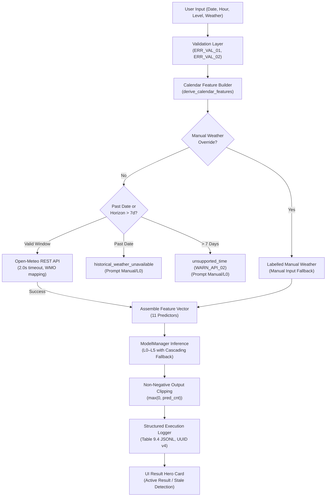

# Smart Bike Rental Demand Advisor (VELO Dashboard)

A production-grade, machine learning-backed decision-support system for estimating hourly bike-sharing demand in Washington, D.C. Built strictly in compliance with **Software Requirement Specification (SRS v1.5)** using Python, Scikit-Learn, and Streamlit.

---

## 1. Project Overview & Problem Statement

Urban bike-sharing systems face acute spatial and temporal demand imbalances. Commuter surges during morning and evening rush hours rapidly deplete docks in residential zones and overwhelm commercial stations, while inclement weather drastically suppresses ridership.

The **Smart Bike Rental Demand Advisor (VELO Dashboard)** addresses this challenge by providing fleet managers and operational dispatchers with accurate, real-time, hourly demand forecasts. Rather than burdening the operator with manual entry of complex meteorological variables, the application automatically retrieves live forecast weather from the **Open-Meteo API**, translates calendar dynamics, applies pre-trained machine learning models, and outputs expected demand alongside historical error bounds and full audit records.

---

## 2. Project Objectives & Scope

### In-Scope Objectives
* **Data Sanitization & Preprocessing:** Ingestion and validation of the canonical UCI Bike Sharing hourly dataset (`dataset/hour.csv`), astronomical season derivation, and min-max normalization.
* **Multi-Tier Model Ladder (L0–L5):** Progressive evaluation of historical baseline heuristics and supervised learning models on an identical chronological 80/20 train/test split.
* **Automated Weather Integration:** Real-time retrieval of Washington, D.C. hourly weather conditions via the Open-Meteo Forecast REST API with a strict 2.0s network timeout.
* **Labelled Manual Weather Override:** Deterministic operational fallback enabling manual condition entry when external APIs are unreachable or for past dates.
* **Auditability & Execution Logging:** Structured, thread-safe append-only execution logging conforming to SRS v1.5 Table 9.4 with distinct RFC 4122 UUID v4 identifiers and recursive secret redaction.
* **Interactive VELO Dashboard:** Five-page responsive Streamlit application featuring live predictions, stale-state warnings, baseline performance comparisons, and exploratory data analytics.

### Out-of-Scope & Operational Disclaimers (SRS Section 1.2 & 11)
* **Present-Day Accuracy:** The model is trained on historical records from 2011–2012; present-day operational accuracy is not independently verified.
* **Station-Level Inventory:** The system estimates aggregate city-wide hourly demand; it does not provide GPS-level tracking, dock availability, or bike redistribution routing.
* **Commercial Operations:** Booking, payments, user account management, and bike hardware telemetry are out of scope.
* **Online Retraining:** Automatic model retraining on live streaming feeds is excluded.

---

## 3. Dataset Source & Attribution

* **Source:** UCI Machine Learning Repository — [Bike Sharing Dataset (Dataset 275)](https://archive.ics.uci.edu/dataset/275/bike+sharing+dataset).
* **Reference:** Fanaee-T, H., & Gama, J. (2013). Event labeling combining ensemble detectors and background knowledge. *Progress in Artificial Intelligence*, Springer.
* **Licence:** Creative Commons Attribution 4.0 International (CC BY 4.0). Attribution retained.
* **Geographic Coverage:** Capital Bikeshare system, Washington, D.C. (Coordinates: $38.8951^\circ\text{N}, 77.0364^\circ\text{W}$, Timezone: `America/New_York`).
* **Temporal Coverage:** January 1, 2011 00:00 to December 31, 2012 23:00 (two full calendar years).

---

## 4. Dataset Integrity & Schema (`dataset/hour.csv`)

The raw dataset file is preserved immutably at [`dataset/hour.csv`](dataset/hour.csv):

| Metric / Check | Specification | Verified Value |
| :--- | :--- | :--- |
| **Record Count** | 17,379 hourly records | **17,379 rows** (UCI web listing shows 17,389; verified at load time) |
| **Attribute Count** | 17 raw columns | **17 columns** |
| **Missing Values** | 0 nulls across all cells | **0 missing / 0 nulls** |
| **Duplicates** | 0 duplicate instances | **0 duplicate rows** |
| **Unit of Observation** | One calendar hour of bike-sharing activity | Verified |
| **Target Variable (`cnt`)** | Total hourly rentals (integer $\ge 0$) | Mean: 189.46, Median: 142.0, Range: [1, 977] |
| **Sum Constraint (C-2)** | $casual + registered == cnt$ | **100.0% adherence (17,379 / 17,379 rows)** |
| **Target Leakage Guard** | Prohibit components from feature vector | `casual` and `registered` strictly excluded |
| **Index Exclusion** | Exclude row index | `instant` strictly excluded |
| **Temporal Leakage Guard** | Exclude dataset year (Design Decision D6) | `yr` strictly excluded to ensure validity for future years |

---

## 5. Data Preprocessing & Feature Engineering

### Astronomical Season Mapping (SRS Section 4.4 & Appendix A)
While the UCI text documentation lists generic season labels, the actual calendar records in `hour.csv` transition around astronomical solstices and equinoxes. The project adheres to SRS v1.5 specification:
* **Code `1` (Winter):** Jan 1 – Mar 20, and Dec 21 – Dec 31 (Winter Solstice: Dec 21)
* **Code `2` (Spring):** Mar 21 – Jun 20 (Spring Equinox: Mar 21)
* **Code `3` (Summer):** Jun 21 – Sep 22 (Summer Solstice: Jun 21)
* **Code `4` (Fall):** Sep 23 – Dec 20 (Autumnal Equinox: Sep 23)

### Weather Feature Normalization (SRS Appendix B)
API and manual weather parameters are normalized to $[0.0, 1.0]$ using documented UCI bounds:
$$\text{temp}_{\text{norm}} = \frac{T - (-8)}{39 - (-8)} = \frac{T + 8}{47}$$
$$\text{atemp}_{\text{norm}} = \frac{AT - (-16)}{50 - (-16)} = \frac{AT + 16}{66}$$
$$\text{hum}_{\text{norm}} = \frac{\text{humidity}\%}{100.0}$$
$$\text{windspeed}_{\text{norm}} = \frac{\text{wind\_kmh}}{67.0}$$
*All normalized values are clipped strictly to $[0.0, 1.0]$ to prevent out-of-range feature values.*

### Active Predictor Vector (11 Features)
The inference matrix strictly uses 11 verified predictors:
`['season', 'mnth', 'hr', 'holiday', 'weekday', 'workingday', 'weathersit', 'temp', 'atemp', 'hum', 'windspeed']`.

---

## 6. Exploratory Data Analysis (EDA) Insights

Implemented in [`src/eda.py`](src/eda.py) with visual charts in [`reports/figures/`](reports/figures/):
1. **Target Distribution:** Positively skewed (+1.28). Mean (189.46) exceeds median (142.0) due to rush-hour commuting spikes. 505 records (2.91%) exceed the upper IQR fence (642.5), 82.0% of which occur during working day peak commute hours.
2. **Hourly Commute Patterns:** Working days exhibit prominent bimodal commuter peaks at **8:00 AM** (mean 477.0 bikes) and **5:00 PM** (mean 525.3 bikes). Non-working days exhibit a broad midday leisure plateau peaking at **1:00 PM** (mean 372.7 bikes).
3. **Seasonal Demand:** Summer records peak average demand (236.0 bikes/hour), followed by Spring (208.3) and Fall (198.9). Winter records the lowest demand (111.1 bikes/hour).
4. **Weather Impact:** Demand decreases monotonically with weather severity: Clear (204.9 bikes) $\to$ Mist/Cloudy (175.2) $\to$ Light Rain/Snow (111.6) $\to$ Heavy Rain (74.3).
5. **Feature Correlation:** Temperature ($r = +0.405$) and hour ($r = +0.394$) have the highest positive correlations with demand; humidity ($r = -0.323$) and weather severity ($r = -0.142$) correlate negatively.

---

## 7. Machine Learning Workflow & Chronological Split

Per SRS v1.5 Section 3.2 and 5.7:
* **Chronological Split:** The 17,379 records are split chronologically without random shuffling (`shuffle=False`):
  * **Training Set (80%):** Earlier 13,903 records (Jan 1, 2011 00:00 $\to$ Aug 7, 2012 05:00).
  * **Held-Out Test Set (20%):** Latest 3,476 records (Aug 7, 2012 06:00 $\to$ Dec 31, 2012 23:00).
* **Zero Leakage:** All baseline group means, normalizers, and regression models are fitted exclusively on training data.
* **Model Artifact Contract (`models/model_bundle.joblib`):** Persisted deployment bundle encapsulates the trained models, L0 training mean, L1–L3 group dictionaries, training/test date boundaries, dependency versions, and held-out test scores.

---

## 8. Multi-Tier Model Hierarchy (L0–L5)

[src/models.py](src/models.py) implements the multi-tier evaluation ladder across six operational tiers:

### Audited Benchmark & Model Metrics
Verified against baseline and model evaluations:
* **Level 0 (L0) Global Mean:** Mean $\mu = 189.46$ bikes/hour; Benchmark $\text{MAE} = 142.41$
* **Level 1 (L1) Hour Mean Baseline:** Benchmark $\text{MAE} = 88.58$
* **Level 2 (L2) Hour + Working Day:** Benchmark $\text{MAE} = 76.54$
* **Level 3 (L3) Hour + Working Day + Season:** Benchmark $\text{MAE} = 69.31$
* **Level 4 (L4) Multiple Linear Regression:** Benchmark $\text{MAE} = 105.47$; $R^2 = 0.390$
* **Level 5 (L5) Random Forest Regressor:** Benchmark $\text{MAE} = 42.18$; $R^2 = 0.887$

### Held-Out Chronological Test Set Evaluation (Artifact Bundle)
Evaluated on the held-out 20% chronological test split (3,476 rows, late 2012):

| Tier | Model / Approach | Description | ML Trained | Held-Out Test MAE | Improvement vs L1 |
| :---: | :--- | :--- | :---: | :---: | :---: |
| **L0** | Overall Mean Baseline | Historical training mean ($\mu \approx 174.64 \to 175$) | No | **174.98** | -53.86% |
| **L1** | Hour Mean Baseline | Group mean by hour of day ($hr \in [0, 23]$) | No | **113.73** | 0.00% (Reference) |
| **L2** | Hour + Working Day | Group mean by ($hr, workingday$) | No | **101.55** | +10.71% |
| **L3** | Hour + Working Day + Season | Group mean by ($hr, workingday, season$) | No | **95.48** | +16.05% |
| **L4** | Multiple Linear Regression | Parametric regression on 11 features | Yes | **134.70** | -18.44% |
| **L5** | Random Forest Regressor | Non-linear ensemble (100 trees, seed 42) | Yes | **85.20** | **+25.09%** |

### Output Clipping & Degradation Fallbacks
* **Non-Negative Constraint:** All predictions are clipped via $\max(0, \hat{y})$ per SRS Section 5.1.
* **Cascading Fallbacks:** If L5 is unavailable on host, the system cascades to L4 (`model_fallback_l4`). If model artifacts are missing or corrupt, it safely degrades to the dynamic L0 mean with warning `WARN_SYS_01`. Total failure halts execution with `ERR_SYS_01` without fabricating numbers.

---

## 9. Prediction Workflow Service Architecture

The prediction workflow is orchestrated in [`src/prediction_service.py`](src/prediction_service.py):



---

## 10. Weather Integration & Manual Override

### Open-Meteo REST Client ([`src/weather.py`](src/weather.py))
* **Coordinates:** $38.8951^\circ\text{N}, -77.0364^\circ\text{W}$ (Washington, D.C.).
* **Timeout & Latency (NFR-1):** Bounded at 2.0 seconds for external Open-Meteo socket requests. Local model inference executes in <20ms; formal multi-sample 95th-percentile live API latency benchmarking remains outstanding.
* **WMO Weather Code Mapping:** Maps Open-Meteo WMO weather codes (0–99) to UCI 4-class scale. Unknown WMO codes trigger `WARN_MAP_01` and reject silent coercion.
* **Past Date Policy:** Past dates reject live forecast retrieval (`historical_weather_unavailable`) to prevent substituting current weather for historical conditions (Constraint C-6).

### Manual Weather Override
Allows operators to specify local weather manually (Temperature in $^\circ\text{C}$, Humidity in $\%$, Wind Speed in $\text{km/h}$, Weather Condition). Outputs are labelled `Manual Input (Labelled Fallback)` with status `manual_override`.

---

## 11. Prediction Lifecycle & State Machine

Implemented in [`app.py`](app.py):
1. **Initial Page Load:** Renders "Ready to Advise Demand" card with blue "Awaiting Submission" pill. Zero predictions run; zero execution logs written.
2. **Predict Demand Submission:** Runs only when user clicks **Predict Demand**. Renders hero prediction card with green **Active Result** badge, predicted count, model name, historical test MAE, and RFC 4122 UUID v4 Request ID.
3. **Stale Parameter Detection:** Compares current input state against session snapshot. If parameters are modified after a run, the hero badge transitions to amber **⚠️ Prior Run** and displays a warning banner: *"Parameters Modified Since Run"*.
4. **Clear Prediction Reset:** Clicking **Clear Prediction** clears session state and restores the initial ready card.
5. **Passive Navigation:** Navigating between sidebar tabs triggers zero redundant predictions or log writes.

---

## 12. Structured Execution Logger (SRS Table 9.4)

Implemented in [`src/logger.py`](src/logger.py) with persistent storage at `logs/execution_log.jsonl`:
* **Exact 12-Field Schema:** `log_id`, `request_id`, `timestamp`, `requested_datetime`, `status`, `error_code`, `weather_source`, `api_status`, `input_vector`, `predicted_cnt`, `model_level`, `model_version`.
* **UUID Separation:** `log_id` is a freshly generated RFC 4122 UUID v4 for every write; `request_id` tracks individual user submissions.
* **Concurrency Safety:** Thread-safe append-only file operations protected by `threading.Lock()`.
* **Self-Healing Log Reader:** `get_recent_logs()` gracefully parses intact records while skipping corrupted, empty, or partial lines.
* **Credential Redaction:** Recursive sanitization at write time and read time masks any key containing `key`, `token`, `secret`, `password`, `auth`, `credential`, or `bearer` with `[REDACTED]`.

---

## 13. Application Architecture & Module Responsibilities

```
Smart_Bike_Rental_Demand_Advisor/
│
├── app.py                     # Streamlit multi-page UI (VELO Design Language)
├── requirements.txt           # Python dependencies
├── .gitignore                 # Excludes dataset, models, .venv, and logs/
├── README.md                  # Comprehensive project documentation
├── SPRINT1_CLOSURE.md         # Sprint 1 verification and audit report
├── SPRINT2_CLOSURE.md         # Sprint 2 verification and audit report
├── SPRINT3_CLOSURE.md         # Sprint 3 verification and audit report
│
├── dataset/
│   └── hour.csv               # Immutable UCI Bike Sharing Dataset (17,379 rows)
│
├── models/
│   └── model_bundle.joblib    # Serialized model artifact & metadata contract
│
├── logs/                      # Runtime execution logs (ignored by Git)
│   └── execution_log.jsonl    # Append-only Table 9.4 execution log
│
├── src/
│   ├── __init__.py            # Module exports
│   ├── baseline.py            # Baseline calculation helpers
│   ├── calendar_utils.py      # Solar-cycle season and calendar derivation
│   ├── data_cleaning.py       # Dataset loader, null checks, schema validation
│   ├── eda.py                 # Statistical analysis, correlations, commute peaks
│   ├── logger.py              # Structured ExecutionLogger (Table 9.4, UUID v4)
│   ├── models.py              # ModelManager, L0–L5 ladder, bundle persistence
│   ├── prediction_service.py  # End-to-end prediction workflow orchestrator
│   ├── validation.py          # Input boundary checks (ERR_VAL_01, ERR_VAL_02)
│   ├── visualization.py       # Matplotlib plotting routines
│   └── weather.py             # Open-Meteo REST client, WMO mapping, normalization
│
├── tests/
│   ├── test_sprint1.py        # Sprint 1 tests (33 tests)
│   ├── test_sprint2.py        # Sprint 2 tests (45 tests)
│   └── test_sprint3.py        # Sprint 3 tests: Logger, Workflow, UI, Regression (76 tests)
│
└── reports/
    └── figures/               # Generated exploratory analysis figures
```

---

## 14. Streamlit Dashboard Usage

Launch the dashboard:
```powershell
streamlit run app.py
```

### Dashboard Pages
1. **Overview:** System summary, key performance indicators (KPIs), operational problem statement, and methodology introduction.
2. **Demand Predictor:** Operational prediction cockpit. Select operational date, hour, weather mode, and evaluation tier. View active demand estimate, historical MAE, weather telemetry, and audit Request ID.
3. **Model Performance:** Comparative evaluation of all six tiers (L0–L5) on the 3,476 held-out test rows, MAE comparison charts, and improvement percentages.
4. **Data Insights:** Deep-dive exploratory charts showing hourly commute spikes, seasonal trends, weather severity impacts, and Pearson correlation heatmaps.
5. **About Project:** Academic metadata, GLA University credits, supervisor review, system architecture, and operational disclaimers.

---

## 15. Testing Strategy & Verification Evidence

Run the complete automated discovery suite:
```powershell
python -m unittest discover -s tests -v
```

### Verified Test Results (154 / 154 Passing)
* **`tests/test_sprint1.py` (33 tests):** Data cleaning, UCI schema validation, statistical distributions, season boundaries, and L0 baseline invariance.
* **`tests/test_sprint2.py` (45 tests):** Multi-tier ModelManager, cascading fallbacks (L5 $\to$ L4 $\to$ L0), Open-Meteo error handling, artifact contract persistence, corrupt bundle degradation, and LaTeX MAE rendering.
* **`tests/test_sprint3.py` (76 tests):**
  * *UUID & Schema:* RFC 4122 UUID v4 validation and 12-field Table 9.4 adherence.
  * *Security:* Recursive write-time and read-time secret redaction.
  * *Concurrency:* Multi-threaded log writes under high contention.
  * *Prediction Service (TC-13):* End-to-end validation, weather branching, and fallback cascades.
  * *Streamlit UI:* Predict button guards, input snapshotting, stale warnings, and Clear button reset.
  * *Comprehensive Regression:* Boundary hours (0 and 23), multiple date representations, sub-zero and extreme weather, and corrupt file self-healing.

### Automated Headless Chrome CDP Verification
The Streamlit frontend was validated via Google Chrome (`chrome.exe --headless=new`) using the Chrome DevTools Protocol:
* Check 1: Initial page load renders ready card; zero logs written (PASS).
* Check 2: Submit valid prediction request (PASS).
* Check 3: Prediction hero card renders with active pill, count, model, MAE (PASS).
* Check 4 & 5: UI displays valid UUID v4 Request ID matching disk log record (PASS).
* Check 6: Modifying input triggers amber "Prior Run" badge and warning banner (PASS).
* Check 7: Clear Prediction restores ready state and clears hero card (PASS).
* Check 8: Passive navigation causes zero duplicate logs (PASS).

---

## 16. Installation & Execution Guide (Windows, PowerShell, VS Code)

### Prerequisites
* Windows 10 / 11
* Python 3.10 to 3.14
* Git

### Step-by-Step Setup

1. **Clone the Repository:**
   ```powershell
   git clone https://github.com/kushagrapratapsingh-30/smart-bike-rental-demand-advisor.git
   cd Smart_Bike_Rental_Demand_Advisor
   ```

2. **Create and Activate a Virtual Environment:**
   ```powershell
   python -m venv .venv
   .\.venv\Scripts\Activate.ps1
   ```

3. **Install Dependencies:**
   ```powershell
   pip install --upgrade pip
   pip install -r requirements.txt
   ```

4. **Run Automated Test Suite:**
   ```powershell
   python -m unittest discover -s tests -v
   ```
   *Expected output: Ran 154 tests in ~2.5s — OK.*

5. **Launch Streamlit Application:**
   ```powershell
   streamlit run app.py
   ```
   *The application will open automatically in your browser at `http://localhost:8501`.*

6. **VS Code Recommended Configuration:**
   * Open folder in VS Code: `code .`
   * Select Python Interpreter: Press `Ctrl+Shift+P` $\to$ `Python: Select Interpreter` $\to$ Choose `.\.venv\Scripts\python.exe`.
   * Run tests from the VS Code Testing side-panel or terminal.

---

## 17. Academic Traceability & Institutional Credits

* **Institution:** GLA University, Greater Noida — Department of Computer Science & Engineering
* **Program:** Bachelor of Technology in Computer Science & Engineering (AI / ML)
* **Author / Student:** Kushagra Pratap Singh (Roll No. 22515500052, Section NE [L2])
* **Academic Supervisor:** Mr. Palash Singh Raghuwanshi (GLA University, Greater Noida)
* **Project Reviewer:** Mr. Gautam Mukherjee (GLA University, Greater Noida)
* **Specification Version:** SRS v1.5 (October 2026)
* **Current Status:** Sprint 3 Complete — Audited, Tested, and Closed.
